<a href="https://applepie-blog.vercel.app">
  <picture>
    <source media="(prefers-color-scheme: dark)" srcset="./assets/banner-dark.svg">
    
  </picture>
</a>

&nbsp;
&nbsp;

<a href="https://applepie-blog.vercel.app"><picture><source media="(prefers-color-scheme: dark)" srcset="./assets/card-blog-dark.svg"></picture></a>
<a href="https://study-bookshelf.vercel.app"><picture><source media="(prefers-color-scheme: dark)" srcset="./assets/card-shelf-dark.svg"></picture></a>

<picture>
  <source media="(prefers-color-scheme: dark)" srcset="https://github-readme-stats.vercel.app/api/top-langs/?username=weierliteln&layout=compact&langs_count=6&hide_border=true&bg_color=1c1d22&title_color=f2f2f4&text_color=9da0aa&border_radius=28&card_width=830&custom_title=%E5%B8%B8%E7%94%A8%E8%AF%AD%E8%A8%80">
  
</picture>

